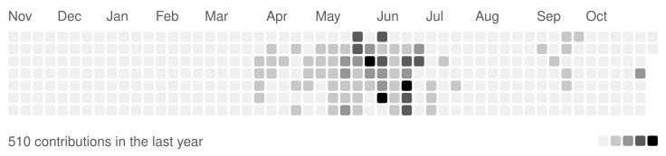

## 이형동 AX Engineer

안녕하세요, AX 개발자 이형동입니다. 
백엔드를 기반으로 AI 에이전트 시스템을 만들고 반복되는 업무를 자동화합니다. 
Codex와 Claude Code를 한 팀처럼 움직이게 하는 Voruvi를 만들었습니다. 
AI가 낸 결과는 그대로 믿지 않고, 테스트와 코드로 확인하는 구조를 중요하게 생각합니다. 
기획부터 배포와 운영까지 맡고, 서비스는 직접 구축한 서버에서 돌립니다.

## Projects

**[Voruvi](https://www.voruvi.com)** &nbsp; `Python` `Codex` `Claude Code` 
개발 요청을 AI 에이전트 팀에 맡기고 결과까지 검사하는 Windows 앱

**Agent Harness** &nbsp; `Python` `Claude Code` `SQLite` 
AI 에이전트의 권한, 승인, 검증 단계를 코드로 통제하는 실행 환경

**[AI MVP Orchestrator](https://github.com/hyeongdongE/ai-mvp-orchestrator)** &nbsp; `Spring Boot` `MySQL` `Docker` 
아이디어에서 기획, 프론트 구현, 화면 승인까지 잇는 제품 제작 파이프라인

**[SoloPilot](https://github.com/hyeongdongE/mzapp)** &nbsp; `FastAPI` `PostgreSQL` `React` 
IT 소식 수집과 정리를 5분 브리핑으로 자동화하는 서비스

## Stack

**AI** &nbsp; `Claude Code` `Codex` `Python` `Playwright`

**Backend** &nbsp; `Java` `Spring Boot` `FastAPI` `SQLAlchemy`

**Data** &nbsp; `MySQL` `PostgreSQL` `Redis` `SQLite`

**Frontend** &nbsp; `TypeScript` `React` `React Native` `Expo`

**Infra** &nbsp; `Docker` `GitHub Actions` `Nginx` `Caddy` `Cloudflare Tunnel`

## Contributions

