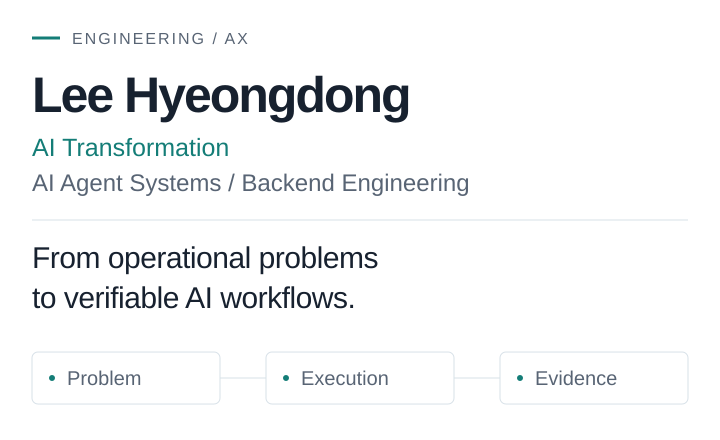

<picture>
  <source media="(prefers-color-scheme: dark)" srcset="assets/hero-dark.svg">
  <source media="(prefers-color-scheme: light)" srcset="assets/hero-light.svg">
  
</picture>

# Lee Hyeongdong

이형동 · **AI Transformation / AI Agent Systems / Backend Engineering**  
*From operational problems to verifiable AI workflows.*

업무의 문제를 분석하고, AI와 소프트웨어로 자동화 시스템을 구현하는 개발자입니다. Agent 작업 분배와 권한 제어, 비정형 데이터의 구조화, 백엔드·외부 API 연동을 다루며, 실행 결과를 검증하고 실패 원인을 추적하는 흐름을 설계합니다.

[Selected Projects](#selected-projects) · [Engineering Approach](#engineering-approach) · [Technical Skills](#technical-skills)

## Areas of Expertise

- **AI Agents & Orchestration** — 목표를 작업으로 나누고, Agent의 역할·권한·산출물 전달 경계를 설계합니다.
- **Workflow Automation** — 기획·구현·승인 단계를 연결하고, 상태 전이와 실패 알림을 관리합니다.
- **Data Processing & Integration** — 외부 API 응답을 공통 모델로 정규화하고, 변경 여부와 발행 조건을 판단합니다.
- **Backend Engineering & Verification** — Spring 기반 API와 저장 계층을 구현하고, 테스트·실행 기록으로 결과를 확인합니다.

## Selected Projects

### 01 / AI Supervisor

**목표 기반 Agent 오케스트레이션 · Closed Beta `0.1.0b1`**

Agent의 완료 보고만으로 작업 품질을 판단하기 어려운 문제를 다룹니다. 개발 프로젝트로서 작업별 권한 제어, 구조화된 산출물 인계, 테스트 증거 확인과 재작업 흐름을 구성했습니다.

- **구현 근거** — 공개 wheel의 권한 교집합 계산, 산출물 필수 필드 검사, 테스트 실행·재작업 경로를 정적 확인했습니다.
- **현재 범위** — 시험판이며 Linux만 실측되었다고 공개 문서에 명시되어 있습니다. 브라우저 상호작용 자동 검증과 운영 배포는 지원 범위에 포함하지 않습니다.

`Python` · `Claude Code CLI` · `Git` · `LLM Agents`

[Repository](https://github.com/hyeongdongE/ai-supervisor) · [Case Study](docs/projects/ai-supervisor.md)

### 02 / AI MVP Orchestrator

**사람의 승인을 포함한 AI 제작 파이프라인**

아이디어에서 화면 검토까지의 작업을 연결하고, 검토되지 않은 결과가 다음 단계로 넘어가는 문제를 다룹니다. 저장소 기여자로서 Spring 기반 Job 상태 관리, 외부 실행 스크립트 연동, 스크린샷 승인 흐름을 개발했습니다.

- **구현 근거** — 기획 검증 → 시각 자료 입력 대기 → 프론트 작업 실행 → 스크린샷 → Discord 승인 요청 경로를 코드에서 확인했습니다.
- **현재 범위** — 최신 Runner는 프론트 승인 후 종료합니다. README의 백엔드·배포까지 이어지는 전체 흐름을 현재 완성 기능으로 소개하지 않습니다.

`Java` · `Spring Boot` · `MySQL` · `Docker` · `REST API`

[Repository](https://github.com/hyeongdongE/ai-mvp-orchestrator) · [Case Study](docs/projects/ai-mvp-orchestrator.md) · [Companion Template](https://github.com/hyeongdongE/ai-app-template)

### 03 / Peakrew

**공공 API 데이터를 서비스에 연결하는 수집·검증 파이프라인**

여러 기관의 활동 정보를 일관된 형식으로 제공하고, 반복 수집과 부적합한 자동 발행을 줄이는 문제를 다룹니다. 저장소 기여자로서 데이터 수집·정규화와 Spring 백엔드를 포함한 서비스 개발에 참여했습니다.

- **구현 근거** — 공통 데이터 모델, SHA-256 내용 해시, SQLite 증분 상태 관리, 발행 사유 기록을 코드에서 확인했습니다.
- **검증 경계** — 공개 테스트로 정규화·발행 판단을 확인할 수 있습니다. 실제 API 가용성이나 서비스 운영 성과와는 구분합니다.

`Python` · `Java` · `Spring Boot` · `MySQL` · `SQLite` · `TypeScript`

[Repository](https://github.com/hyeongdongE/peakrew) · [Case Study](docs/projects/peakrew.md)

## Engineering Approach

**Problem → Data → Design → Automation → Verification → Improvement**

1. **Problem / Data** — 반복되는 판단과 데이터 경계를 정의합니다. Peakrew는 기관별 응답을 공통 모델로 정리합니다.
2. **Design / Automation** — 작업·상태·승인 경계를 명시합니다. Orchestrator는 시각 자료 입력과 프론트 승인에 대기 상태를 둡니다.
3. **Verification / Improvement** — 결과와 근거를 함께 남깁니다. Supervisor는 테스트 증거와 지적 사항을 후속 작업·재작업에 연결합니다.

## Technical Skills

공개 구현에서 사용을 확인한 기술입니다. 숙련도 등급을 의미하지 않습니다.

- **Languages** — Python · Java · SQL · TypeScript
- **Backend & Infrastructure** — Spring Boot · REST API · MySQL · SQLite · Docker · Git
- **AI & Automation** — LLM Agents · Agent Orchestration · Workflow Automation · Structured Data Processing
- **System Integration** — External API Integration · Discord Webhooks · S3-compatible Object Storage

## Experience & Recognition

공개 프로젝트를 중심으로 Agent 실행 제어, 승인 기반 자동화, 데이터 처리·백엔드 연동을 구현하고 있습니다.

추가 프로젝트는 제공받은 경험을 바탕으로 정리 중입니다. 아래 문서는 완성된 기술 성과 소개가 아니라 **공개 증빙 준비 현황**입니다.

- [AI-Based Circuit Verification Automation](docs/projects/circuit-verification.md) — 기업연계 프로젝트. 내부 코드·데이터·고객 자료는 공개하지 않습니다.
- [Smart Fish Tank AIoT](docs/projects/smart-fish-tank.md) — 팀장 경험(본인 제공). 구현 자료·수상·전시의 정확한 명칭은 추가 확인이 필요합니다.

소개 범위와 근거: <a href="docs/EVIDENCE.md">Evidence Notes</a> · 유지보수: <a href="docs/PROFILE_DESIGN_GUIDE.md">Design Guide</a>
