업무를 AI Agent에게 맡기되 권한은 작업 단위로 좁히고, 완료 여부는 테스트와 코드로 판정하는 시스템을 만듭니다.

## Projects

<a href="https://www.voruvi.com"><picture><source media="(prefers-color-scheme: dark)" srcset="assets/voruvi-dark.svg"><source media="(prefers-color-scheme: light)" srcset="assets/voruvi-light.svg"></picture></a>
<a href="https://github.com/hyeongdongE/hyeongdongE/blob/main/docs/projects/solopilot.md"><picture><source media="(prefers-color-scheme: dark)" srcset="assets/solopilot-dark.svg"><source media="(prefers-color-scheme: light)" srcset="assets/solopilot-light.svg"></picture></a>
<a href="https://github.com/hyeongdongE/hyeongdongE/blob/main/docs/projects/ai-mvp-orchestrator.md"><picture><source media="(prefers-color-scheme: dark)" srcset="assets/orchestrator-dark.svg"><source media="(prefers-color-scheme: light)" srcset="assets/orchestrator-light.svg"></picture></a>
<a href="https://github.com/hyeongdongE/hyeongdongE/blob/main/docs/projects/peakrew.md"><picture><source media="(prefers-color-scheme: dark)" srcset="assets/peakrew-dark.svg"><source media="(prefers-color-scheme: light)" srcset="assets/peakrew-light.svg"></picture></a>

<b>코드로 확인하기</b>

 

**Voruvi** · [v0.1.0b1 릴리스](https://github.com/hyeongdongE/ai-supervisor/releases/tag/v0.1.0b1)의 AI Supervisor wheel 기준, [사례 문서](docs/projects/ai-supervisor.md)

- `registry/verify.py`: 격리된 임시 Git 저장소에서 Agent를 돌려 5가지를 확인합니다.
- `supervisor/permission.py`: 요청 권한과 작업에 필요한 권한의 교집합만 줍니다.
- `supervisor/pipeline.py`: 테스트를 직접 실행하고, 지적이 나오면 앞 단계로 되감습니다.

**SoloPilot** · 실제 LLM 호출은 꺼져 있습니다, [사례 문서](docs/projects/solopilot.md)

- [품질 평가 기록](https://github.com/hyeongdongE/mzapp/blob/ebacc3f89784251e31f6c27876b6dd708da4fd5b/docs/it-intelligence/quality-evaluation.md): 잘못된 병합 0/25건, 중복 누락 0/12건.
- [Golden Dataset 테스트](https://github.com/hyeongdongE/mzapp/blob/ebacc3f89784251e31f6c27876b6dd708da4fd5b/tests/intelligence/test_golden_dataset.py), [읽기 시간 계산](https://github.com/hyeongdongE/mzapp/blob/ebacc3f89784251e31f6c27876b6dd708da4fd5b/app/intelligence/reading_time.py)

**AI MVP Orchestrator** · [사례 문서](docs/projects/ai-mvp-orchestrator.md)

- [프론트 실행 흐름](https://github.com/hyeongdongE/ai-mvp-orchestrator/blob/003c3470c28874de2a1dd13d694001e643fc29e4/src/main/java/com/aiworker/ai_mvp_orchestrator/job/service/OrchestrationRunner.java#L101-L140), [승인 처리](https://github.com/hyeongdongE/ai-mvp-orchestrator/blob/003c3470c28874de2a1dd13d694001e643fc29e4/src/main/java/com/aiworker/ai_mvp_orchestrator/approval/service/ApprovalService.java), [AI App Template](https://github.com/hyeongdongE/ai-app-template)

**Peakrew** · [사례 문서](docs/projects/peakrew.md)

- [발행 판정 규칙](https://github.com/hyeongdongE/peakrew/blob/35be5688bc5af68b8c5b1eb035184653542bdff7/crawler/opportunity_crawler/publish_gate.py#L190-L237), [내용 해시](https://github.com/hyeongdongE/peakrew/blob/35be5688bc5af68b8c5b1eb035184653542bdff7/crawler/opportunity_crawler/models.py#L51-L92), [증분 상태](https://github.com/hyeongdongE/peakrew/blob/35be5688bc5af68b8c5b1eb035184653542bdff7/crawler/opportunity_crawler/state.py)
- [수집기 테스트](https://github.com/hyeongdongE/peakrew/blob/35be5688bc5af68b8c5b1eb035184653542bdff7/crawler/tests/test_core.py), [백업 복구 리허설](https://github.com/hyeongdongE/peakrew/blob/35be5688bc5af68b8c5b1eb035184653542bdff7/.github/workflows/production-db-backup-restore-rehearsal.yml)

수치의 기준과 한계는 [검증 기록](docs/EVIDENCE.md)에 있습니다.

## Stack

`Claude Code` `Codex` `Python` `Playwright` `Java` `Spring Boot` `FastAPI` `SQLAlchemy` `MySQL` `PostgreSQL` `Redis` `SQLite` `Flyway` `Alembic` `TypeScript` `React` `React Native` `Expo` `Docker Compose` `GitHub Actions` `Nginx` `Caddy` `Cloudflare Tunnel`
