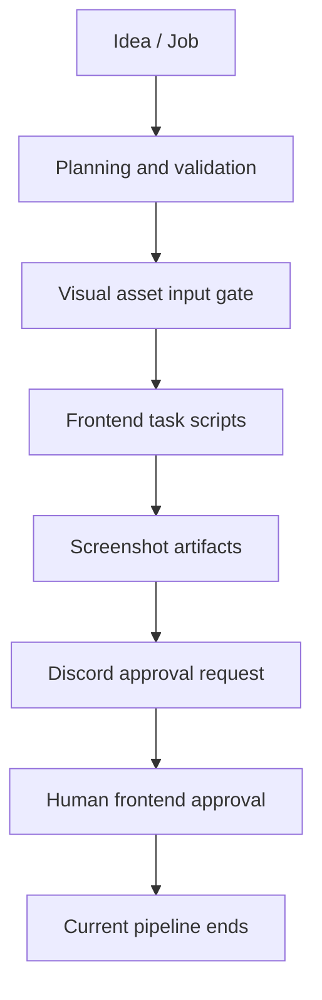

# AI MVP Orchestrator

[← Profile](../../README.md) · [Repository](https://github.com/hyeongdongE/ai-mvp-orchestrator)

## Overview

아이디어 입력 이후 기획·프론트 구현·스크린샷 승인 요청을 연결하는 Spring 애플리케이션입니다. 아래 설명은 공개 코드 `003c3470c288` 기준입니다.

## Problem

자동 생성된 화면을 검토하지 않고 API 구현이나 배포로 진행하면 요구사항의 불일치가 후속 단계로 전파될 수 있습니다.

## My Role

저장소 기여자로서 자동화 파이프라인과 백엔드 개발에 참여했습니다. 공개 contributors에서 계정 기여를 확인했습니다. 세부 기능별 단독 담당 여부는 별도 작업 기록으로 보강해야 합니다.

## System Architecture

## Implementation

- Job 상태를 저장하면서 기획 검증, 자료 입력 대기, 프론트 실행과 스크린샷 촬영 단계를 진행합니다.
- 시각 자료 게이트는 설정으로 제어하며, 대기 상태에서 재개하는 별도 진입점이 있습니다.
- 승인 객체와 토큰 기반 승인 URL을 생성하고 Discord로 알립니다.
- 예외 발생 시 Job을 실패 상태로 바꾸고 알림을 시도합니다.
- 로컬·R2 저장 서비스가 존재합니다. 서비스 존재와 실제 운영 검증은 구분합니다.

## Verification

[실행 순서·종료 경계](https://github.com/hyeongdongE/ai-mvp-orchestrator/blob/003c3470c28874de2a1dd13d694001e643fc29e4/src/main/java/com/aiworker/ai_mvp_orchestrator/job/service/OrchestrationRunner.java)와 [승인 처리](https://github.com/hyeongdongE/ai-mvp-orchestrator/blob/003c3470c28874de2a1dd13d694001e643fc29e4/src/main/java/com/aiworker/ai_mvp_orchestrator/approval/service/ApprovalService.java)를 정적으로 검토했습니다. `continueAfterFrontendApproval`은 종료 로그만 남기며 백엔드·배포를 실행하지 않습니다. 실제 Codex·Discord·R2·배포 환경을 연결한 E2E 실행은 이번 검증에 포함하지 않았습니다.

## Results

공개 코드로 확인되는 결과는 프론트 승인 요청까지 연결된 실행 경로와 Job 상태·실패 처리 구조입니다. 기존 README에 기재된 백엔드 생성·리뷰·Staging·Production 전체 흐름은 최신 Runner의 완료 기능으로 볼 수 없습니다.

## Lessons Learned

설계에서 읽히는 트레이드오프: 사람의 승인 경계는 자동 진행 범위를 제한하는 대신 화면 검토 시점을 명확히 합니다. 외부 CLI·스크립트의 성공과 오케스트레이터 자체의 상태 전이는 별도로 검증해야 합니다.

다음 증빙: 비밀값을 제거한 Job 실행 기록, 실패 후 처리 기록, 승인 화면의 실제 캡처. 자동 재시도·운영 배포 성공은 증빙 전까지 성과로 쓰지 않습니다.
