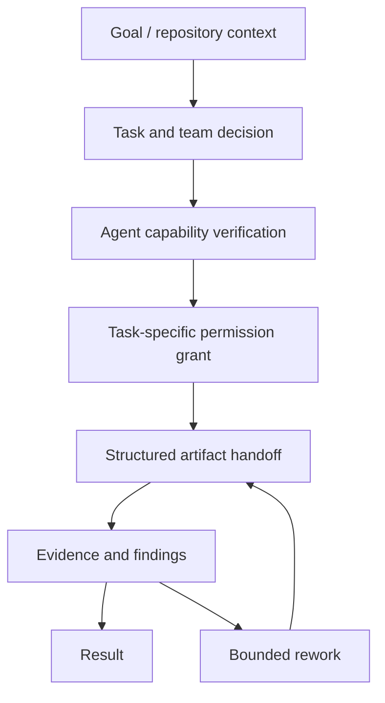

# AI Supervisor / Evidence-driven Agent Systems

[← Profile](../../README.md) · [Repository](https://github.com/hyeongdongE/ai-supervisor) · [Public Beta Release](https://github.com/hyeongdongE/ai-supervisor/releases/tag/v0.1.0b1)

## Overview

Claude Code CLI 위에서 목표 분석과 Agent 협업을 지원하는 `0.1.0b1` Closed Beta입니다. 정식 출시·운영 검증 완료 서비스로 소개하지 않습니다.

## Problem

Agent가 파일 수정이나 테스트 통과를 주장해도 실제 결과와 일치하는지 별도 확인이 필요합니다. 협업 단계가 늘면 앞 단계의 불일치도 후속 작업으로 전달될 수 있습니다.

## My Role

사용자가 대표 개발 프로젝트로 제공한 작업입니다. 공개 배포본의 구현을 확인했으나, 기여자별 세부 역할과 단독 구현 범위는 확인하지 못했습니다.

## System Architecture

## Implementation

공개 Git 소스 트리에는 README만 있지만, 공개 wheel에는 읽을 수 있는 Python 모듈이 포함됩니다. 배포본을 설치·실행하지 않고 압축을 풀어 다음을 정적으로 확인했습니다.

- `supervisor/permission.py`: Agent 요청 권한과 작업에 필요한 권한의 교집합을 계산합니다.
- `registry/verify.py`: 임시 Git 저장소에서 capability를 확인하는 실행 경로가 있습니다.
- `supervisor/artifacts.py`: 산출물 필수 필드, `stands_on`, 요구사항 `covers`, 지적의 `against`를 정의합니다.
- `supervisor/pipeline.py`: 테스트 명령 실행과 결과 판정, 지적에 따른 되감기 경로가 있습니다.

## Verification

검토한 파일: `aisupervisor-0.1.0b1-py3-none-any.whl`  
SHA-256: `08f157e4799f3aa2971fcf7a593d1fe652e91bd3a5e40935082bfa6573adaffc`

재현: 공개 Release의 wheel 다운로드 → ZIP 도구로 압축 해제 → 위 모듈 확인. 코드가 존재한다는 검증이며 실제 Agent 실행·성공률·권한 격리의 완전성을 보증하지 않습니다. Claude 계정이나 사용량이 필요한 실행은 수행하지 않았습니다.

README는 자동 되감기를 실행당 2회로 설명하지만, wheel의 `pipeline.run` 기본 인자에는 `max_rework=3`이 보입니다. 호출 경로별 설정과 동작을 실행 검증하기 전에는 고정 횟수를 성과로 소개하지 않습니다.

## Results

공개 배포와 근거 기반 실행 제어 구조를 확인했습니다. README에 따르면 Linux만 실측했고 브라우저 클릭 이후 검증은 사람 몫이며, 시험이 없는 저장소에서는 완료 판정에 한계가 있습니다. 해당 문서의 비용·시간 실측값은 독립 재현하지 않아 프로필 성과로 사용하지 않았습니다.

## Lessons Learned

설계에서 읽히는 트레이드오프: 팀 오케스트레이션은 검토 단계를 늘리지만 시간과 비용도 늘릴 수 있습니다. 작업 규모에 따른 팀 선택과 산출물 검증은 따로 평가해야 합니다.

Voruvi와 이 배포본의 관계는 공개 근거가 없어 동일 제품·후속 버전으로 표기하지 않습니다.
