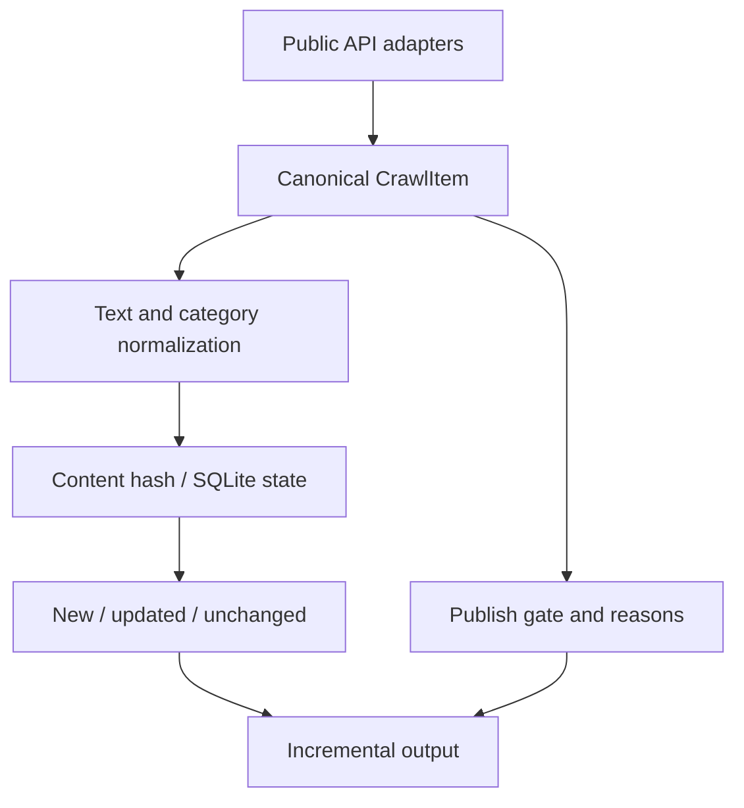

# Peakrew / Data Processing & Integration

[← Profile](../../README.md) · [Repository](https://github.com/hyeongdongE/peakrew)

## Overview

대학생 활동 탐색·크루 플랫폼 중 공공 API 수집·정규화·발행 판단에 초점을 맞춘 사례입니다. 기준 커밋: `35be5688bc5a`.

## Problem

기관마다 데이터 필드와 분류가 다르고, 같은 항목이 반복 조회됩니다. 정보가 있다고 해서 모두 서비스에 자동 발행하기 적합한 것도 아닙니다.

## My Role

저장소 기여자로서 데이터 처리와 백엔드를 포함한 서비스 개발에 참여했습니다. 공개 contributors에서 계정 기여를 확인했습니다. 각 모듈의 단독 설계·구현 여부는 별도 기록으로 보강해야 합니다.

## System Architecture

## Implementation

- API별 Adapter를 공통 `CrawlItem`에 연결합니다. 원본 필드와 정규화한 분류를 함께 보존합니다.
- 정규화된 내용으로 SHA-256 해시를 만들고, 출처별 ID 또는 URL을 키로 SQLite 상태를 관리합니다.
- `new`, `updated`, `unchanged`를 구분해 출력 범위를 선택합니다. 기관 간 의미상 동일한 공고를 완전히 식별한다는 뜻은 아닙니다.
- 필수 필드·출처별 조건을 검사하고 `publishGate.reasons`에 발행 판단 근거를 남깁니다.

## Verification

[공통 모델·해시](https://github.com/hyeongdongE/peakrew/blob/35be5688bc5af68b8c5b1eb035184653542bdff7/crawler/opportunity_crawler/models.py), [증분 상태](https://github.com/hyeongdongE/peakrew/blob/35be5688bc5af68b8c5b1eb035184653542bdff7/crawler/opportunity_crawler/state.py), [발행 규칙](https://github.com/hyeongdongE/peakrew/blob/35be5688bc5af68b8c5b1eb035184653542bdff7/crawler/opportunity_crawler/publish_gate.py), [공개 테스트](https://github.com/hyeongdongE/peakrew/blob/35be5688bc5af68b8c5b1eb035184653542bdff7/crawler/tests/test_core.py)를 확인했습니다.

로컬 공개 테스트 실행 결과는 [검증 기록](../EVIDENCE.md)에 기록합니다. 실제 API 인증·가용성·실사용자 환경은 이번 실행에 포함하지 않습니다.

## Results

데이터 구조화, 변경 판단과 발행 여부를 분리한 구현을 공개 코드로 확인할 수 있습니다. 사용자 수, 수집 정확도, 비용 절감률은 검증된 자료가 없어 제시하지 않습니다.

## Lessons Learned

설계에서 읽히는 트레이드오프: 내용 해시는 변경 탐지에 유용하지만 의미적 중복 제거와는 다릅니다. 발행을 보류하는 이유를 기록하면 규칙 수정과 데이터 품질 점검에 활용할 수 있습니다.

실제 화면 자료는 [원본 README의 App Preview](https://github.com/hyeongdongE/peakrew#app-preview)에서 확인할 수 있습니다. 디자인 이미지가 운영 중인 화면이라는 보장은 하지 않습니다.
