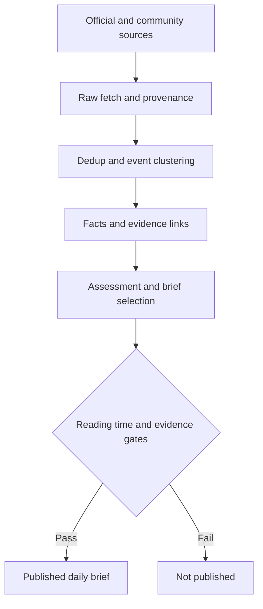

# SoloPilot / Evidence-grounded Daily Intelligence

[← Profile](../../README.md) · [Repository](https://github.com/hyeongdongE/mzapp)

## Overview

정해진 커뮤니티, 메인테이너, 공식 IT 소스를 모아 근거가 붙은 일일 브리핑을 만들고, 읽는 시간을 5분 이내로 제한하는 서비스입니다. 저장소 이름은 `mzapp`이고 기준 커밋은 `ebacc3f89784`입니다.

## Problem

IT 소식은 여러 곳에 흩어져 있고 같은 사건이 반복됩니다. 요약 결과가 그럴듯해도 어떤 근거에서 나왔는지 확인할 수 없으면 믿고 쓰기 어렵습니다.

## My Role

저장소 커밋과 PR 작성자로 확인했습니다. 기능별 단독 담당 범위는 별도 기록으로 보강해야 합니다.

## System Architecture

## Implementation

- FastAPI, SQLAlchemy, Alembic, PostgreSQL 기반 백엔드와 React PWA로 구성됩니다.
- 브리핑 항목은 `BriefItemFact(event_fact_id, event_evidence_id)` 스냅샷으로 사실과 근거를 정확히 연결합니다.
- 잘못된 병합을 치명 오류로, 중복 누락을 그보다 낮은 오류로 다루는 비대칭 게이트를 둡니다.
- 운영 환경은 Docker Compose와 Caddy로 구성되어 있고 내부 경로는 프록시에서 404로 막습니다.

## Verification

[품질 평가 기록](https://github.com/hyeongdongE/mzapp/blob/ebacc3f89784251e31f6c27876b6dd708da4fd5b/docs/it-intelligence/quality-evaluation.md) 기준 수치입니다. 평가일은 2026-09-23, 기준 커밋은 `a229c14`입니다. 이 프로필 작업에서 다시 실행하지 않았습니다.

| 항목 | 기록 |
| --- | --- |
| Golden Dataset | 50건 |
| 잘못된 병합 | 0 / 25건 |
| 중복 누락 | 0 / 12건 |
| 근거 없는 주장 (기록 데이터 E2E) | 0 / 14건 |
| 최종 읽기 시간 (기록 데이터 E2E) | 52초 |
| 백엔드 테스트 | 359개 통과 |
| 프론트 테스트 | 16개 통과 |

## Results

평가 중 실제 replay에서 멱등성 결함을 발견해 회귀 테스트를 먼저 쓰고 수정한 기록이 남아 있습니다. 실제 LLM과 Meta 연동은 비활성이고, 운영 카테고리는 데이터 근거가 쌓일 때까지 공개하지 않습니다. 사용자 수나 정확도 성과는 제시하지 않습니다.

## Lessons Learned

설계에서 읽히는 트레이드오프: 게이트를 엄격히 두면 발행량이 줄지만 틀린 내용을 내보낼 위험도 줄어듭니다. 기록 데이터 평가는 실제 운영 품질과 구분해서 다뤄야 합니다.
